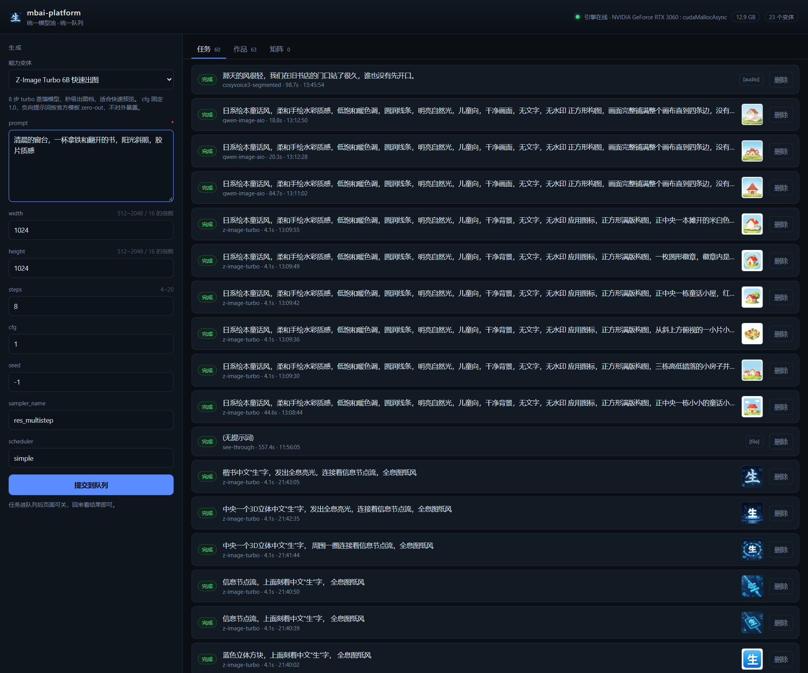
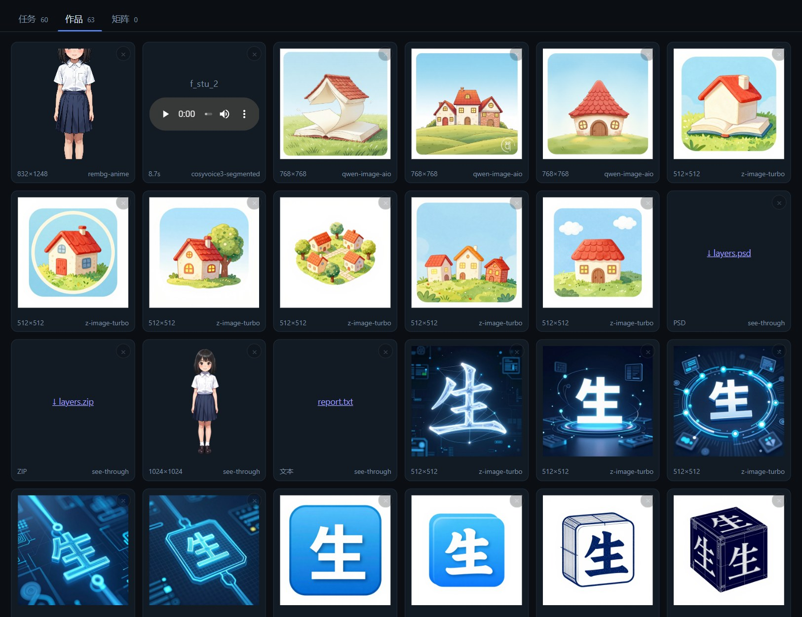
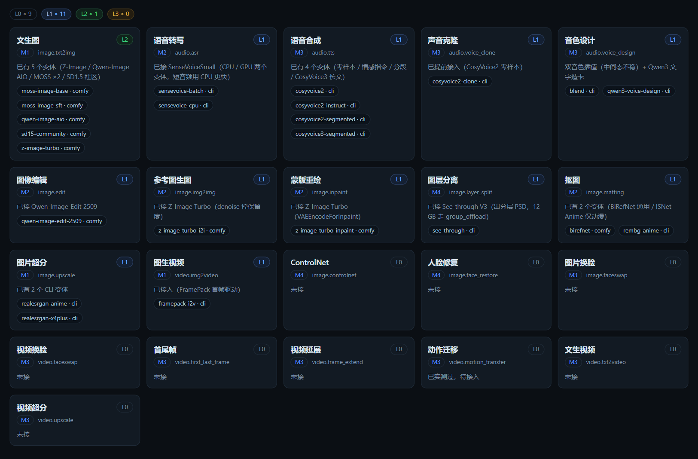
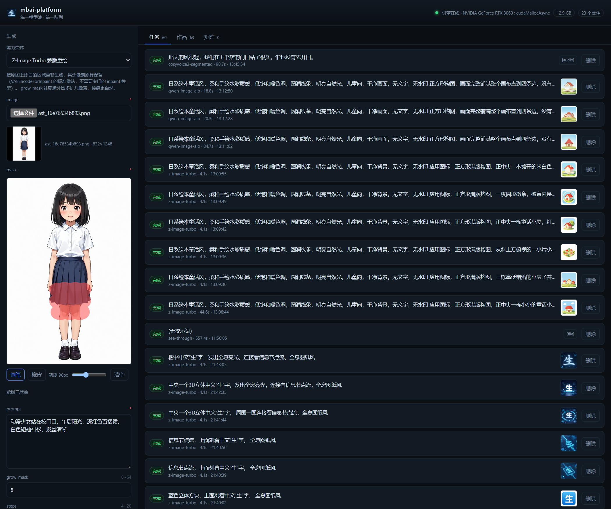
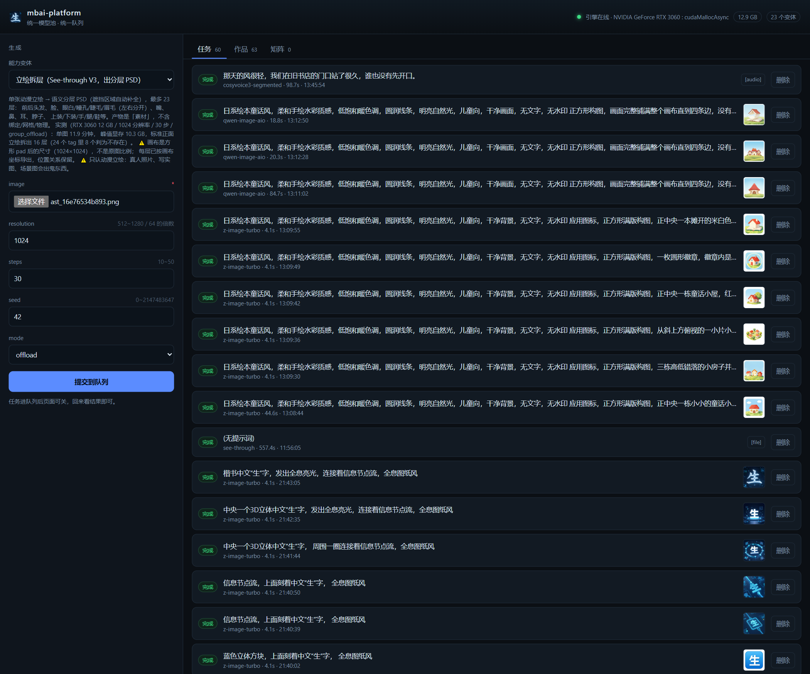
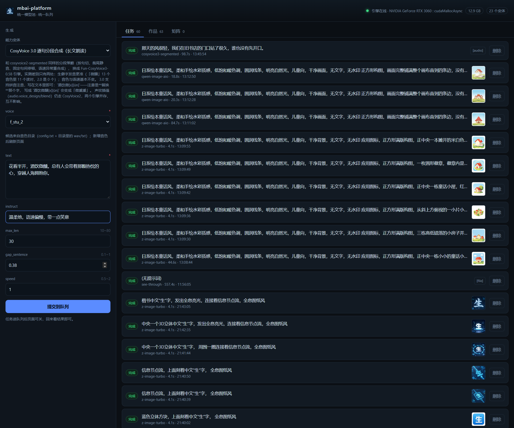
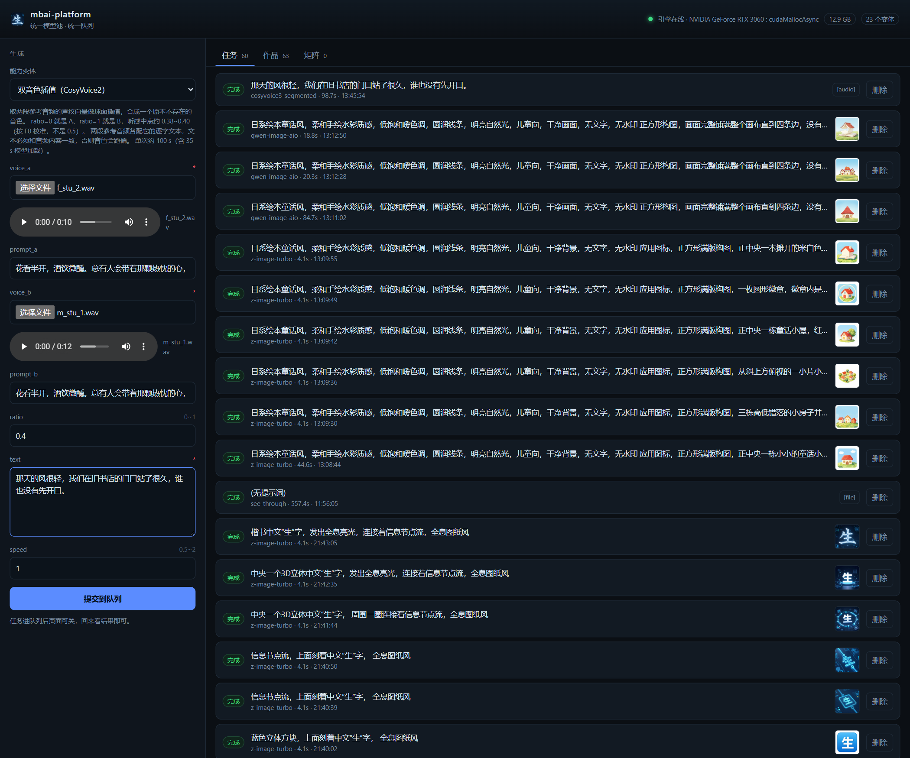
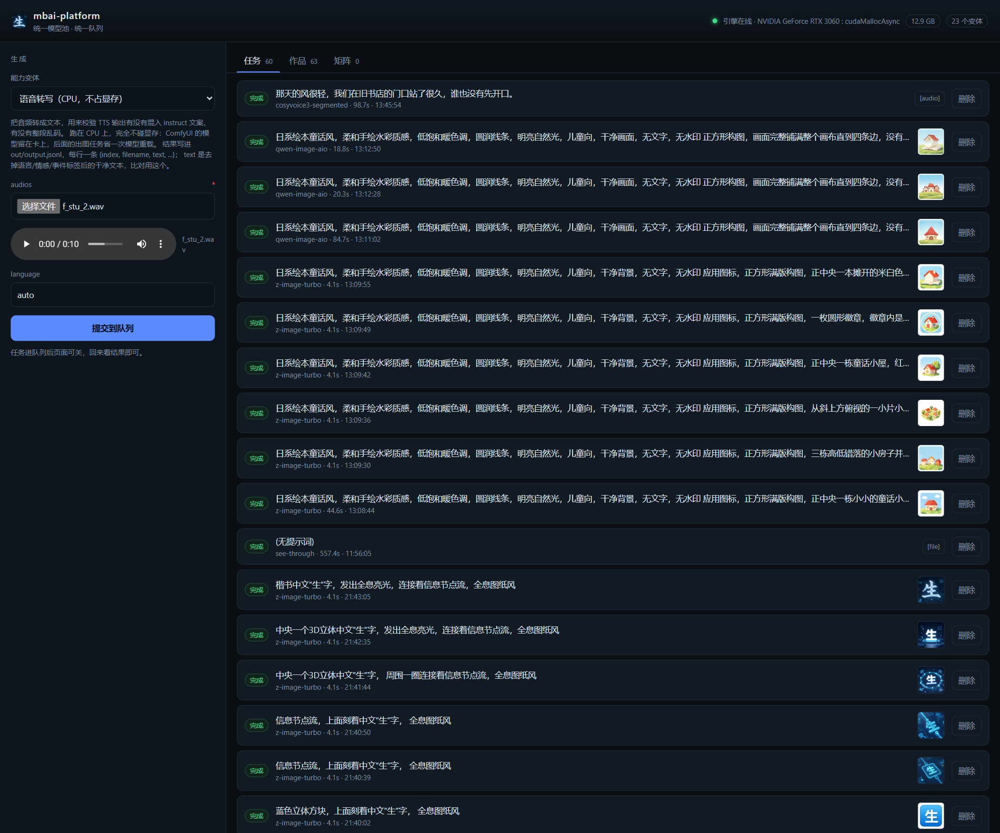
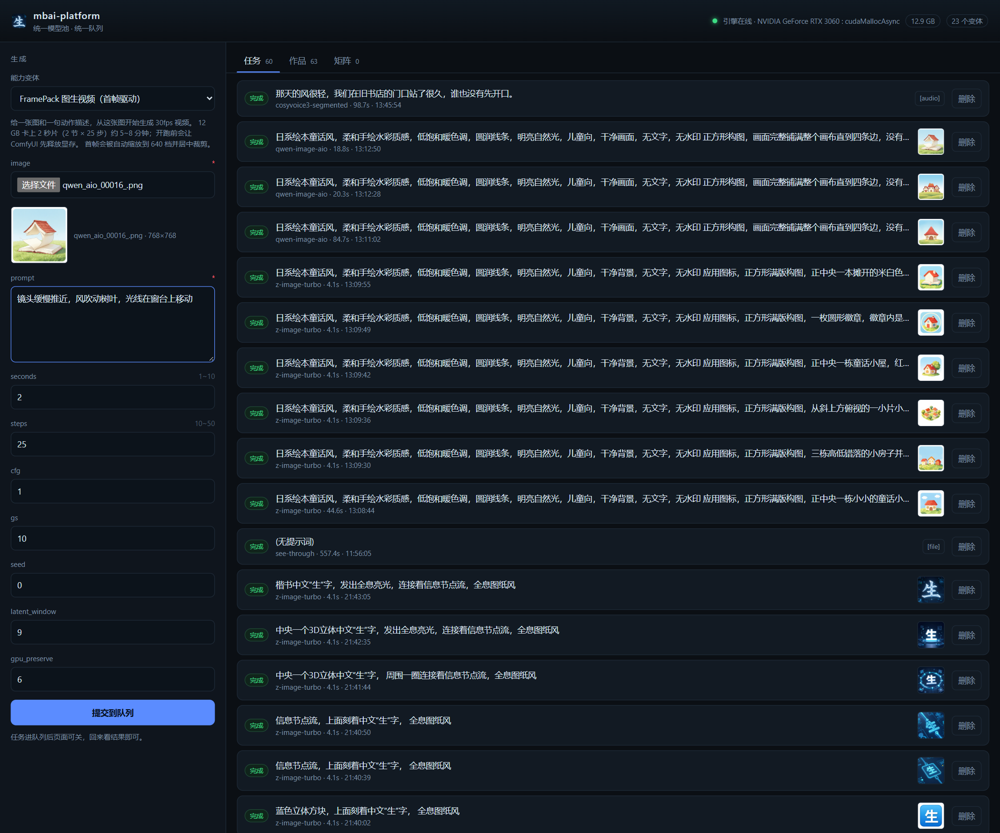

<p align="center">
  
</p>

# mbai-platform


**一站式本地 AI 能力平台**：生图 / 改图 / 蒙版重绘 / 抠图 / 超分 / 立绘拆层 / 图生视频 /
语音合成 / 音色克隆 / 音色设计 / 语音转写，一套 REST 接口 + 一个网页 + 一个 MCP 服务交给本地智能体调用。
单卡 RTX 3060 12GB / Windows 上实测跑通。

| 分组 | 已接能力 | 变体数 |
|---|---|---|
| 图片 | 文生图（5 个模型）、指令改图、参考图生图、蒙版重绘、抠图（通用 / 动漫）、超分（2 个）、立绘拆层（分层 PSD） | 13 |
| 音频 | 语音合成（4 个）、音色克隆、音色设计（插值 / 文字造卡）、语音转写（CPU / GPU） | 9 |
| 视频 | 首帧驱动图生视频（FramePack 分节生成） | 1 |

**12 项能力 / 23 个变体**已接；矩阵里另有 9 项明确标「未接」（ControlNet、换脸、人脸修复、视频延展……），
不糊弄。产物有五种形态：图片、视频、音频、文本、二进制文件（PSD / ZIP）。
每个变体的模型、引擎与选用边界见 [能力清单](#能力清单当前)。

设计原则：**不自研推理内核**。ComfyUI 当模型运行时，平台只做控制平面（能力注册表、统一队列、产物库、引擎适配器）。

> 给 Agent / 新接手的人：先读 **[AGENTS.md](AGENTS.md)**，架构约束、契约、踩过的坑都在那里。

## 界面

**总览** —— 左边选能力变体，表单按 `manifest.yaml` 的 `inputs` 自动生成（这里是 Z-Image Turbo 的
prompt / 尺寸 / 步数 / 采样器）；右边是统一队列，图片、音频、文本、PSD 混在一个列表里，2 秒轮询。



**作品墙** —— 五种产物同屏：抠图的透明 PNG（`rembg-anime`）、音频卡片（内联播放 + 音色名）、
文生图、PSD / ZIP（不内联，直接给下载链接）、文本（拆层的质检报告）。点右上角 `×` 连任务带产物一起删。



**能力矩阵** —— 21 项能力按成熟度 L0~L3 排：已接的展开到「变体 · 引擎」，
没接的直说「未接」，实测过但还没接的也标出来。当前 L1×11、L2×1、L0×9。



**蒙版重绘** —— 在原图上直接涂（屏幕上红色 = 要重画的区域），涂完停手约 0.5 秒自动上传，
然后照常提交。不需要专门的 inpaint 模型，见 [蒙版重绘](#蒙版重绘局部重绘)。



**立绘拆层** —— 单张动漫立绘 → 语义分层 PSD（遮挡区域自动补全），参数只有分辨率 / 步数 / 种子 /
显存档。12 GB 卡走 `--group_offload`，1024 分辨率约 9~12 分钟，产物是 PSD + 层包 ZIP + 预览 + 质检报告。



**语音合成** —— 音色直接下拉（候选来自本机音色目录，选中即试听参考音频），
`instruct` 写自然语言情绪指令；分段长度 / 句间停顿 / 语速都有默认值。
音频任务走本地 CLI 引擎，**ComfyUI 没开也能提交**。



**音色设计（插值）** —— 两段参考音频 + 各自的逐字文本，`ratio` 决定偏向哪一端
（听感中点约 0.38~0.40，不是 0.5）。产物是普通 wav，想常驻就固化进音色目录。



**语音转写** —— 用来校验 TTS 产物：把合成好的音频转回文本，抓「整段乱码」「instruct 被念进正文」
这类问题。产物是 `output.jsonl`，每行一条，`text` 已去掉情感/语言标签。



**图生视频** —— FramePack 首帧驱动，给一张图 + 一句动作描述就出 30fps 视频；
2 秒片约 5~8 分钟，开跑前会先释放 ComfyUI 占的显存。



## 目录

```
AGENTS.md        给 Agent 的交接文档（先读这个）
docs/            方案与实测记录（platform-plan-v2.md 是当前有效版本）
platform_core/   控制平面代码
apps/api/        FastAPI 入口（同时托管前端构建产物）
apps/web/        React + Vite 前端
capabilities/    能力清单：<能力>/<变体>/<版本>/{manifest.yaml,workflow.json}
models/          模型注册表（YAML，只有元数据，权重在 PLATFORM_MODELS_DIR）
profiles/        本机模型绑定（local.yaml 与 local-models.json 不入库，只提交 example）
scripts/         引导、下载、启动、验证脚本
.env.example     配置模板（复制成 .env，.env 不入库）
LICENSE/NOTICE   Apache-2.0 正文与第三方声明
engines/comfy/   ComfyUI 本体（git clone，不入库）
data/            SQLite、产物、日志（不入库）
```

## 快速开始

```powershell
# 0. 配置：复制模板，按本机改模型池等路径（详见下一节）
Copy-Item .env.example .env

# 1. 平台依赖
uv sync

# 2. 引擎：clone 固定 commit + 生成模型挂载 + 建 venv + 装 cu130 torch 与依赖
powershell -ExecutionPolicy Bypass -File scripts\bootstrap-comfy.ps1

# 3. 权重：按 models/*.yaml 的 source 字段还原（约 18.5 GB，走 hf-mirror，缺什么下什么）
uv run python scripts\download-models.py

# 4. 本地 CLI 工具（超分用，约 30 MB）
powershell -ExecutionPolicy Bypass -File scripts\download-tools.ps1

# 5. 前端
npm --prefix apps/web install
npm --prefix apps/web run build

# 6. 预检（注册表 / 模型文件 / 引擎 / MOSS 节点）
uv run mbai doctor

# 7. 跑一张（不走队列，看真实耗时）
uv run mbai run --variant moss-image-sft --prompt "一只戴墨镜的柴犬，赛博朋克街头"
```

## 配置（`.env`）

**所有本机差异都在仓库根目录的 `.env` 里**，代码里没有你的盘符。

- `.env` 已被 `.gitignore` 忽略，不会进版本库
- 模板是 [`.env.example`](.env.example)：`Copy-Item .env.example .env` 后按本机改
- 变量前缀统一 `PLATFORM_`，与 `platform_core/settings.py` 的字段一一对应
- `env_file` 钉在仓库根，**从任何工作目录启动都读同一份 `.env`**
- 改完 `.env` 要重启服务；只有 `mbai` 命令自己会重新加载

最小可运行配置（只跑图片/超分时只需要这两行）：

```ini
# 模型池：ComfyUI 的目录约定（diffusion_models/ text_encoders/ vae/ ...）
PLATFORM_MODELS_DIR=D:/models
# 已有 ComfyUI 安装的权重目录，只读挂载、不复制（JSON 数组，没有就写 []）
PLATFORM_EXTRA_MODEL_DIRS=["F:/AI/ComfyUI/models"]
```

| 变量 | 默认 | 说明 |
|---|---|---|
| `PLATFORM_MODELS_DIR` | `~/ai-models` | 模型热池，**必须按本机改** |
| `PLATFORM_EXTRA_MODEL_DIRS` | `[]` | 额外只读挂载（JSON 数组） |
| `PLATFORM_DATA_DIR` | `<仓库>/data` | 产物 / SQLite / 日志，跟着仓库走 |
| `PLATFORM_TOOLS_DIR` | `<仓库>/tools` | `download-tools.ps1` 的落地点 |
| `PLATFORM_COMFY_URL` | `http://127.0.0.1:8188` | ComfyUI 地址 |
| `PLATFORM_API_URL` | `http://127.0.0.1:8000` | 平台地址（MCP 客户端连它） |
| `PLATFORM_WORKER_CONCURRENCY` | `1` | 单卡串行；多卡再改 |

选装引擎（CosyVoice2 / CosyVoice3 / Qwen3-TTS / FramePack / See-through 拆层 / ASR 转写 / rembg 抠图）
各有一组路径变量，见 `.env.example`。**没配也不会影响图片能力**：只在使用该变体时启动前报错，
提示你缺哪个变量，不会静默跑一个空路径。


可选：**音频引擎 CosyVoice2**（`audio.tts` / `audio.voice_clone` / `audio.voice_design` 用）。
它要独立 conda 环境和 4.8 GB 模型，不装不影响图片/视频：

```powershell
powershell -ExecutionPolicy Bypass -File scripts\bootstrap-cosyvoice.ps1
# 需要代理时（git / conda / pip 共用）：-Proxy http://127.0.0.1:7897
# 只要环境不要 4.8 GB 模型：-SkipModels
```

它做的事：clone CosyVoice 固定 commit `86e26f54` + Matcha-TTS 子模块 → 建 conda 环境
（python 3.10，pynini 来自 conda-forge）→ 装 torch 2.3.1+cu121 与锁定依赖 → 按 sha 下模型
（3.7 GB，约 40 分钟）→ 把 `PLATFORM_COSYVOICE_*` 写进 `.env`。幂等，断了重跑会从断点续。

模型**必须钉 revision**（`9d5c22a8`，2024-12-13）：2025-04-07 之后模型仓库把 `cosyvoice.yaml`
改成了 `cosyvoice2.yaml`、权重也换成 cache 版，需要更新的代码才认，而平台钉的 commit 只认旧版。
所以脚本不走 `modelscope` 的 snapshot 接口，改成按 sha 逐个文件下载。

日常运行是**两个进程**：

```powershell
# 窗口 A：引擎
powershell -ExecutionPolicy Bypass -File scripts\start-engine.ps1

# 窗口 B：平台（网页 + API 同一个端口）
uv run mbai serve --host 0.0.0.0 --port 8000
```

打开 **http://&lt;本机IP&gt;:8000** 即用。局域网内任何设备同一个地址，不需要再开第二个端口。
（换机器就换成那台机器的 IP，端口不变。）

> 引擎必须跑在 torch **cu130** 上，且**不要**加 `--lowvram`：cu128 会让量化算子退回 eager，
> MOSS-Image 从 1.5 s/it 掉到 6.2 s/it。详见 `docs/moss-image-integration.md`。

### 局域网打不开时先查这一条

Windows 防火墙对 `python.exe` 有**独立的程序级规则**，Block 优先于 Allow，命令行加的端口规则
（`New-NetFirewallRule -LocalPort 8000`）**不能替代**它。首次监听端口时系统会弹「允许访问」窗口，
必须在本机点同意；点过取消/关闭会在 `Public` 配置下留下 Block 规则。

症状：客户端浏览器报 **502**（而不是超时）——因为客户端代理连不上上游时会返回 502，很容易误导成服务挂了。

```powershell
# 看这个解释器有没有被挡
Get-NetFirewallApplicationFilter | Where-Object { $_.Program -match 'uv\\python' } |
  ForEach-Object { $_ | Get-NetFirewallRule } | Select DisplayName,Action,Profile,Enabled
```

## 资产（都不入库，全部可重建）

仓库里**没有任何权重、没有引擎源码、没有产物图**。每一样都有对应脚本，换机器只需按顺序跑：

| 资产 | 体积 | 脚本 / 命令 | 落地位置 |
|---|---|---|---|
| ComfyUI 本体（固定 `d07dff45`） | ~120 MB | `scripts\bootstrap-comfy.ps1` | `engines\comfy\` |
| `extra_model_paths.yaml`（模型挂载） | 几 KB | 同上（按 `-ModelsDir` / `-ExtraModelDirs` 生成） | `engines\comfy\extra_model_paths.yaml` |
| torch 2.14.1+cu130 三件套 | ~3 GB | `scripts\install-comfy-env.ps1`（bootstrap 会调） | `engines\comfy\.venv\` |
| ComfyUI Python 依赖 | ~1 GB | 同上 | 同上 |
| MOSS-Image 权重 4 个文件 | ~18.5 GB | `uv run python scripts\download-models.py` | `<PLATFORM_MODELS_DIR>\` |
| BiRefNet 抠图权重 | ~424 MB | 同上（`--only background_removal`） | `<PLATFORM_MODELS_DIR>\background_removal\` |
| Real-ESRGAN ncnn-vulkan 工具包 | ~30 MB | `powershell -File scripts\download-tools.ps1` | `tools\realesrgan\` |
| 前端依赖与产物 | ~50 MB | `npm --prefix apps/web install && npm run build` | `apps\web\` |
| CosyVoice 仓库（固定 `86e26f54`）+ Matcha-TTS 子模块 | ~120 MB | `scripts\bootstrap-cosyvoice.ps1`（可选） | `engines\cosyvoice\` |
| CosyVoice2-0.5B 模型目录（钉 revision `9d5c22a8`） | ~4.4 GB | 同上 | `engines\cosyvoice\pretrained_models\` |
| CosyVoice conda 环境（py3.10 + pynini + torch cu121） | ~7 GB | 同上 | 系统 conda `envs\cosyvoice\` |
| See-through 仓库（固定 `df019de`）+ uv venv（torch 2.8 cu128） | ~4 GB | `scripts\bootstrap-seethrough.ps1` | `D:\AI\see-through` / `D:\AI\envs\see-through` |
| See-through 权重（HF 缓存） | ~9.5 GB | 首次任务自动下载 | `PLATFORM_SEETHROUGH_HF_HOME` |

下载脚本读的是 **`models/*.yaml` 的 `source` 字段**，不是写死的文件列表：加新模型只要在 YAML 里写清
`repo + remote 路径`，脚本不用改。同一份权重被多个变体共用（比如 MOSS 的文本编码器）只下一次。

- `--check` 只体检不联网；`--dry-run` 只打印命令；`--models-dir E:\models` 换存放位置；`--only vae` 只补单个文件
- 模型池位置可以和本机不同：`download-models.py --models-dir` 与 `PLATFORM_MODELS_DIR` 保持同一个值即可
- 没有 `source` 字段的模型视为「本机已有、不可自动还原」，`doctor` 会明确标出来

注意点：

- HuggingFace 走 `HF_ENDPOINT=https://hf-mirror.com`（脚本已设）；一次传多个 `--include` 会漏文件，所以脚本是**逐个下**
- PyPI 用官方源：清华镜像缺 `comfyui-workflow-templates-media-assets-02`
- torch 走 `download.pytorch.org/whl/cu130`，**不能用 cu128**
- `download-moss.ps1` 末尾会校验大小，抓「下到一半断掉」

## 网页界面

单端口方案：`apps/web` 构建到 `apps/web/dist`，由 FastAPI 挂 `StaticFiles` 托管在 `/`，
`/v1/*` 仍是 API。所以 `http://<本机IP>:8000` 一个地址同时是页面和接口。

- **日常使用**：`npm --prefix apps/web run build` 后重启服务即可
- **改前端时**：`npm --prefix apps/web run dev`（5173，热更新，`/v1` 自动代理到 8000）

页面能力：变体下拉 + 按 `manifest.yaml` 的 `inputs` 自动生成表单 + 任务列表（2s 轮询、可取消）
+ 作品墙。`type: image` 的参数是「选文件即上传」，表单里存 `asset_id`，worker 执行前解析成绝对路径
（超分这类能力就靠它）。`type: mask` 不出文件选择框，而是在原图上给一块涂抹画布（见「蒙版重绘」）。生成结果不满意可以直接删：任务行末尾的「删除」和作品缩略图右上角的 `×`，
删的是任务记录 + 磁盘产物文件，不可恢复，会先弹确认框。`prompt` 输入框以 `{` 开头时按 Layout JSON 解析
（排版控制，见 `docs/moss-image-integration.md`），否则按普通文本发送。

## Agent 入口（MCP）

同一个队列两个入口：网页给人，**MCP 给 Agent**。MCP 服务是个薄客户端，走 HTTP 调 `/v1/*`，
因此它能在别的机器上跑（`mbai mcp --url http://<本机IP>:8000`）。

客户端配置（Claude Desktop / opencode 这类）：

```json
{
  "mcpServers": {
    "mbai-platform": {
      "command": "uv",
      "args": ["run", "--directory", "<仓库绝对路径>", "mbai", "mcp"]
    }
  }
}
```

| 工具 | 用途 |
|---|---|
| `list_capabilities` | 全部变体 + 参数定义（`params` 能填什么、哪些必填） |
| `capability_matrix` | 成熟度矩阵，L0 = 还没接 |
| `upload_file` | 本地图片/音频 → `asset_id` |
| `submit` | 入队，立刻返回 `job_id` |
| `wait_job` | 阻塞到终态，返回产物**绝对路径** |
| `job_status` / `list_jobs` | 查单个 / 最近任务 |
| `cancel_job` | 取消排队中、执行中的任务 |

Agent 的一轮典型调用：

```
upload_file("D:/photos/a.png")                              → ast_xxx
submit("image.matting", "birefnet", {"image": "ast_xxx"})    → job_yyy
wait_job("job_yyy")  → succeeded + <仓库>\data\artifacts\job_yyy\matting_00001_.png
```

> 参数名和类型不是猜的：先 `list_capabilities`，`submit` 传错的键会被后端直接拒绝（422 原样回给 Agent）。

## 能力清单（当前）

21 项能力里 **12 项已接、共 23 个变体**，其余 9 项在矩阵里标「未接」。每个变体的选用边界
（`when_to_use` / `avoid_when` / `cost`）写在 manifest 的 `guidance` 块里，`GET /v1/capabilities`
与 `GET /llms.txt` 读的是同一份数据。

| 能力 | 变体 | 模型 | 引擎 | 产物 |
|---|---|---|---|---|
| `image.txt2img` | `z-image-turbo` | Z-Image Turbo 6B int8（8 步，快） | ComfyUI | 图片 |
| `image.txt2img` | `qwen-image-aio` | Qwen-Image AIO 合并版（26.5 GB，质量档） | ComfyUI | 图片 |
| `image.txt2img` | `moss-image-sft` | MOSS-Image 5B SFT int8（版式强） | ComfyUI | 图片 |
| `image.txt2img` | `moss-image-base` | MOSS-Image 5B Base int8 | ComfyUI | 图片 |
| `image.txt2img` | `sd15-community` | A1111 链过来的 SD1.5 检查点（8 个，下拉切换 + 可选 LoRA） | ComfyUI | 图片 |
| `image.edit` | `qwen-image-edit-2509` | Qwen-Image-Edit 2509 fp8 + Lightning 4 步 | ComfyUI | 图片 |
| `image.img2img` | `z-image-turbo-i2i` | Z-Image Turbo 6B int8（denoise 控保留度） | ComfyUI | 图片 |
| `image.inpaint` | `z-image-turbo-inpaint` | Z-Image Turbo 6B int8（蒙版重绘） | ComfyUI | 图片 |
| `image.matting` | `birefnet` | BiRefNet（输出透明 PNG） | ComfyUI | 透明 PNG |
| `image.matting` | `rembg-anime` | ISNet Anime（**仅动漫人物**，孔洞/白边明显更干净） | CLI（独立 uv venv） | 透明 PNG |
| `image.layer_split` | `see-through` | See-through V3（动漫立绘 → 分层 PSD，12 GB 走 group_offload） | CLI（独立 uv venv） | 图片 + PSD + ZIP + 文本 |
| `image.upscale` | `realesrgan-anime` | realesr-animevideov3 | CLI（ncnn-vulkan） | 图片 |
| `image.upscale` | `realesrgan-x4plus` | realesrgan-x4plus | CLI（ncnn-vulkan） | 图片 |
| `audio.tts` | `cosyvoice2` | CosyVoice2-0.5B（零样本，音色从本机清单里选） | CLI（独立 conda 环境） | 音频 |
| `audio.tts` | `cosyvoice2-instruct` | CosyVoice2-0.5B（音色 + 自然语言指令定情绪/语速） | CLI（独立 conda 环境） | 音频 |
| `audio.tts` | `cosyvoice2-segmented` | CosyVoice2-0.5B（长文按句切分，固定句间停顿） | CLI（独立 conda 环境） | 音频 |
| `audio.tts` | `cosyvoice3-segmented` | CosyVoice3-0.5B（分段 + 生僻字注音 `微[x][ūn]`） | CLI（独立 conda 环境） | 音频 |
| `audio.voice_clone` | `cosyvoice2-clone` | CosyVoice2-0.5B（上传参考音频克隆，不入音色清单） | CLI（独立 conda 环境） | 音频 |
| `audio.voice_design` | `blend` | CosyVoice2-0.5B（两段嗓音插值成一个新音色） | CLI（独立 conda 环境） | 音频 |
| `audio.voice_design` | `qwen3-voice-design` | Qwen3-TTS VoiceDesign（一句话描述造音色卡） | CLI（独立 uv venv） | 音频 + 文本 |
| `audio.asr` | `sensevoice-cpu` | SenseVoiceSmall（CPU，不占显存，默认选它） | CLI（独立 uv venv） | 文本（jsonl） |
| `audio.asr` | `sensevoice-batch` | SenseVoiceSmall（GPU，跑前卸载 ComfyUI 模型） | CLI（独立 uv venv） | 文本（jsonl） |
| `video.img2video` | `framepack-i2v` | FramePack I2V HY（首帧驱动，分节生成） | CLI（独立便携环境） | 视频 |

### 换模型版本不用改代码

变体只声明「要哪些角色」（扩散模型 / 文本编码器 / VAE），具体用哪个文件由本机 `profiles/local.yaml` 决定：

```yaml
# profiles/local.yaml（不入库）
z-image-turbo:
  diffusion_model: diffusion_models/zImageTurboQuantized_fp8E4m3fn.safetensors
```

优先级：`profiles/local.yaml` → `profiles/default.yaml` → `models/*.yaml` 的 `files`。
换量化档、换自己 merge 的模型，只改这一行，变体/工作流/前端/Agent 全都不动。
详见 `profiles/example.yaml` 与 AGENTS.md §4.2。

### 运行时选权重（SD1.5 检查点 / LoRA）

老的 A1111 权重不用搬家，**符号链接进来即可**（不复制、不占空间、源目录照常用）。
源路径写在 `profiles/local-models.json`（不入库），先复制模板再改：

```powershell
Copy-Item profiles\local-models.example.json profiles\local-models.json   # 改成自己的路径
powershell -ExecutionPolicy Bypass -File scripts\link-local-models.ps1 -WhatIf  # 先预演
powershell -ExecutionPolicy Bypass -File scripts\link-local-models.ps1         # 建链接
```

清单两个字段：`links`（手工挑的单文件，逐条写理由）和 `bulk`（整目录镜像，LoRA 用）。
模型池路径取自 `.env` 的 `PLATFORM_MODELS_DIR`，也可以用 `-ModelsDir` 临时覆盖。

脚本把权重链到模型池的两个子目录，然后 `image.txt2img/sd15-community` 的
`checkpoint` / `lora` 下拉就自动列出来（候选是请求时现扫目录，刷新页面即可）：

```
<PLATFORM_MODELS_DIR>\checkpoints\sd15\   单文件链接（示例里 8 个 SD1.5 检查点）
<PLATFORM_MODELS_DIR>\loras\sd15\         整目录镜像（示例里 92 个 LoRA）
```

不想要的直接删链接，刷新页面候选就少了，不用改任何 YAML。
注意 SD1.5 原生 512，超过 768 容易出双头；画质本身打不过 z-image-turbo，
留着是为了风格专精（游戏图标、二次元线稿）和复现老图。

## 配置音色（语音合成）

`audio.tts` 的 `voice` 下拉来自**本机**的音色清单，加音色不用改代码、不用重启。
两个来源按名字合并（不区分大小写，`config.txt` 优先）：

### 方式 A：往音色目录丢一对文件（推荐）

目录由 `.env` 的 `PLATFORM_COSYVOICE_VOICES` 指定（示例见 `.env.example`）：

```
voiceclone/
  Xiaoming.wav     ← 参考音频
  Xiaoming.txt     ← 这段音频的逐字文本（UTF-8）
```

文件名（不含扩展名）就是下拉里显示的音色名。**两个文件缺一不可**——
没有 `.txt` 的 wav 不会出现，因为零样本合成必须知道音频里说的是什么，否则音色会跑偏。

### 方式 B：在 config.txt 登记

`PLATFORM_COSYVOICE_CONFIG` 指向的文件（格式沿用老项目，可留空）一行一个，格式 `名字|wav路径|参考文本`：

```
小明|./voiceclone/xiaoming.wav|今天天气不错，我们出去走走吧。
```

- 相对路径按 `config.txt` 所在目录解析，也可以写绝对路径（音频不在 voiceclone 里时用这个）
- 这是老 Flask 项目的格式，已经登记的照旧有效
- 名字重复时 `config.txt` 优先（`Alice` 和 `alice` 算同一个）

### 参考音频的硬要求

| 项 | 要求 |
|---|---|
| 时长 | 5~15 秒。太短音色不稳，太长没必要（参考音频整体要过一遍编码器） |
| 内容 | 单人说话、无背景音乐、无明显噪声 |
| 文本 | 必须和音频**逐字一致**，建议连标点一起抄——差一个字音色就会偏 |
| 格式 | wav 最稳；mp3/flac 也能读，但脚本会重采样到 16k，wav 最省事 |

### 生效与验证

改完**刷新页面**即可，清单每次请求现读，不用重启服务。命令行核对：

```powershell
uv run python -c "from platform_core.voices import list_voices; [print(v.name, v.source, v.wav) for v in list_voices()]"
```

`source` 是 `config` / `dir` / `builtin`，能看出这个音色是从哪儿来的。

### 一次性音色：不用动清单

只临时用一次的参考音频，直接用 `audio.voice_clone` 变体：上传音频 + 填逐字文本即可，
不写进任何目录。

### 选不到怎么办

| 现象 | 原因 |
|---|---|
| 新丢的 wav 没出现 | 缺同名 `.txt`，或 `.txt` 是空的 |
| `config.txt` 里加的不出现 | 路径写错 / 文件不存在；或整行以 `#` 开头被当注释跳过 |
| 下拉是空的 | `cosyvoice_home` 指错了，连兜底的 `asset/zero_shot_prompt.wav` 都找不到 |
| 提示「音色不存在」 | 入队前校验拦下的，按提示里的可选列表改名 |

## 语音转写（ASR）

用来**校验 TTS 的产物**：把合成好的音频转回文本，和原始台词比对，抓「instruct 被念进正文」
「整段乱码」「串话」这类问题。也能当普通转写用。

### 怎么调

```powershell
# 1. 上传音频，拿到 asset id
curl.exe -F "file=@D:/path/to/output.wav" http://127.0.0.1:8000/v1/assets

# 2. 提交（audios 是数组，一次可以传多条）
curl.exe -X POST http://127.0.0.1:8000/v1/jobs -H "Content-Type: application/json" -d "{\"capability\":\"audio.asr\",\"variant\":\"sensevoice-cpu\",\"params\":{\"audios\":[\"ast_xxx\"]}}"

# 3. 产物是 output.jsonl，直接看
curl.exe http://127.0.0.1:8000/v1/jobs/<job_id>/file/output.jsonl
```

**注意 TTS 产物不是 asset。** 要把某条 TTS 结果拿去做 ASR，得先 `POST /v1/assets` 上传一次
（走 `GET /v1/jobs/{id}/file/output.wav` 拿到文件，或直接用磁盘路径）。这是刻意的：
平台只认 asset id，不认任意路径。

### 输出格式

`output.jsonl`，每行一条：

```json
{"index":0,"filename":"ast_b6b6.wav","text":"根本停不下来。","raw":"<|zh|><|ANGRY|><|Speech|><|withitn|>根本停不下来。","duration_s":1.41,"elapsed_s":0.078,"rtf":0.078}
```

- `text` 是去掉 `<|zh|><|ANGRY|>` 这类标签后的干净文本，**比对用这个**
- `raw` 保留原始标签，需要语言/情感/事件信息时看它
- 单条失败只影响那一行（带 `error`），不拖垮整批

**不要把 emoji 当正文**：`rich_transcription_postprocess` 会把情感标签转成 emoji 塞进文本，
对逐字比对是噪音，所以脚本刻意没用它，只用正则去标签。

### CPU 还是 GPU：实测数据，不是直觉

| | 端到端（3 条短音频） | 固定开销 | 每条增量 |
|---|---|---|---|
| `sensevoice-cpu` | **10.9 s** | 约 11 s（Python 启动 + import 7.5 s、加载 3.5 s） | 0.1~0.15 s |
| `sensevoice-batch` | 12.0 s | 约 12 s（含 CUDA 上下文初始化） | 0.03~0.09 s |

**短音频上 GPU 反而更慢。** 模型只有 234M，1~2 秒的句子单条推理本来就只要 0.1 秒，
省下的那点时间完全被 CUDA 初始化的固定开销吃掉。而且 `sensevoice-batch` 带
`free_comfy_vram: true`，跑之前会把 ComfyUI 的模型踢掉，下一张图要多付 10~15 秒重载。

所以：**默认用 `sensevoice-cpu`**。GPU 版只在「单条音频很长」或「一次几百条」时才有意义。
这条边界写在两个变体的 `guidance` 块里，`GET /v1/capabilities` 会原样下发，
Agent 自己就能判断该选哪个。

### 新机器怎么还原

```powershell
# 1. 环境（uv，不是 conda；funasr 在 Windows 全是 pip wheel）
uv venv D:\AI\envs\asr-cpu --python 3.12
uv pip install --python D:\AI\envs\asr-cpu\Scripts\python.exe funasr torch torchaudio

# GPU 版（可选）：torch 走 pytorch 官方 index，注意和 CPU 版是不同的 venv
uv venv D:\AI\envs\asr-cuda --python 3.12
uv pip install --python D:\AI\envs\asr-cuda\Scripts\python.exe torch torchaudio --index-url https://download.pytorch.org/whl/cu128
uv pip install --python D:\AI\envs\asr-cuda\Scripts\python.exe funasr

# 2. 权重（约 936 MB）；hf-mirror 限流时改用 modelscope
D:\AI\envs\asr-cpu\Scripts\python.exe -c "from modelscope import snapshot_download; snapshot_download('iic/SenseVoiceSmall', local_dir=r'D:\AI\models\asr\SenseVoiceSmall')"

# 3. 写 .env
# PLATFORM_ASR_PYTHON=D:/AI/envs/asr-cpu/Scripts/python.exe
# PLATFORM_ASR_CUDA_PYTHON=D:/AI/envs/asr-cuda/Scripts/python.exe
# PLATFORM_ASR_MODEL=D:/AI/models/asr/SenseVoiceSmall
```

两个 venv 共用同一份权重，只有解释器不同。

### 能力边界（别指望它做逐字校对）

- **抓大错，不抓小错**：整段乱码、instruct 泄露、串话能抓到；只错一个字时
  ASR 的语言模型很可能直接"纠正"成正确的那句，比对不出来。
- **中文准、英文准，方言看模型**：`language` 可以指定 `zh/en/ja/ko/yue`，默认 `auto`。
- **它不判断音色、不判断情绪好不好**：情感标签只在 `raw` 里，仅供参考。

## 双音色插值（音色设计）

`audio.voice_design/blend`：取两段参考音频的声纹向量做球面插值，合成一个**原本不存在**的音色，
再用这个音色把 `text` 读出来。用途是给小说配音/播报捏一个「不是任何一个真人」的声音。

| 参数 | 说明 |
|---|---|
| `voice_a` / `prompt_a` | A 的参考音频 + 它的逐字文本 |
| `voice_b` / `prompt_b` | B 的参考音频 + 它的逐字文本 |
| `ratio` | 0 = A，1 = B。**听感中点约 0.38~0.40，不是 0.5**（按 F0 校准出来的） |
| `text` / `speed` | 要合成的台词、语速 |

两段参考音频的时长不必相等（脚本会等长截断），但短的那段决定了可用 token 数，
**低于 5 秒会明显发飘**。单次约 55~100 秒，其中约 35 秒是模型加载。

产物是普通 wav。想让它变成常驻音色（之后在 `audio.tts` 下拉里直接选），
把 wav 和一段**与音频逐字一致**的 txt 一起放进音色目录即可，见上一节。

> 已知限制：插值点落在声纹空间的「无人区」，中间档（尤其 ratio 0.5~0.6）模型可能在男声/女声之间跳，
> 稳定性不如两端。要稳定就把结果固化下来再复用，不要每次重新插值。

## 蒙版重绘（局部重绘）

`image.inpaint` 只重画原图上涂出来的那块区域，其余像素原样保留。**不需要专门的 inpaint 模型**：
ComfyUI 的 `VAEEncodeForInpaint` 会把蒙版外的 latent 锁住，Z-Image Turbo 直接就能用。

用法：

1. 选「Z-Image Turbo 蒙版重绘」，上传原图
2. 在原图下方的画布上直接涂抹：**白（屏幕上显示成红色）= 要重画的区域**，橡皮擦掉 = 保留
3. 提示词描述**整个画面**（模型看到的是完整图 + 蒙版，不是只看那一小块），提交

几个细节：

| 项 | 说明 |
|---|---|
| 笔刷大小 | 是**原图像素**，不是屏幕像素。768 宽的图上 48px 约等于十六分之一宽 |
| `grow_mask` | 往蒙版外多扩几像素，默认 8。接缝生硬就调大，区域溢出就调小 |
| 什么时候生效 | 涂完停手约 0.5 秒自动上传，状态栏出现「蒙版已就绪」才算传上去 |
| 和原图的尺寸关系 | 画布按原图像素尺寸建，导出即对齐；**换原图会清空蒙版** |
| 输出尺寸 | 不是 8 的倍数时会裁掉几个像素（VAE 的硬要求），属于预期行为 |

命令行 / Agent 等价写法：蒙版就是一张黑白 PNG 素材（白 = 重绘），和图片走同一套 `POST /v1/assets`。

```powershell
uv run mbai run --capability image.inpaint --variant z-image-turbo-inpaint `
  --set image=ast_xxx --set mask=ast_yyy --prompt "门口站着一只橘猫，暖色灯光"
```

## 抠图：两个变体怎么选

| 变体 | 模型 | 适合 | 别用 |
|---|---|---|---|
| `birefnet` | BiRefNet 1024（ComfyUI 核心节点） | 通用兜底、场景/静物 | 动漫人物容易留白块 |
| `rembg-anime` | ISNet Anime（rembg CLI） | **动漫 / 二次元人物立绘** | 场景、静物、建筑——主体会被整块删掉 |

### 白边和白块是两个问题

1. **白边（fringe）**：核心节点 `JoinImageWithAlpha` 只改 alpha、保留原 RGB，
   边缘像素仍是「前景 × a + 白背景 × (1−a)」的混合色，合成到非白背景就显形。
   `rembg-anime` 默认用 `decontaminate=white` 反解前景色修掉。
2. **白块（孔洞漏抠）**：脸颊两侧、头发与脖子之间的白色空隙被模型判成前景，alpha 是 **1.0**。
   反混合对它无效，只能换模型。ISNet Anime 对这类小空隙判断明显更准。

实测 10 张动漫人物立绘：边缘亮度中位 **145.7 → 28.8**，孔洞消失，误删 0/10。

### 参数

| 参数 | 默认 | 说明 |
|---|---|---|
| `decontaminate` | `white` | 原图白底（生成图常见）用 `white`；照片/彩色背景用 `auto`（pymatting）；不处理用 `none` |
| `edge_shrink` | `0` | 边缘仍有硬边残留时加 1~2 px，主体会略微变瘦 |

### 边界（重要）

`rembg-anime` **只认动漫人物**。实测草地素材、花拱门、森林小屋三张，输出几乎全透明——
主体被整块删掉。不确定图里是不是动漫人物时，用 `birefnet`。

`isnet-anime` 标注 `commercial_ok: false`（上游授权未确认），商业用途前自行核实。

### 耗时

CLI 一次性进程：**首次约 32 秒**（import onnxruntime + 加载 168 MB 模型），
文件缓存热了之后 **约 2.7 秒/张**。`timeout_sec` 给了 600。

## 加一个新模型

1. `models/<id>.yaml`：写清 files / license / 12GB 可用性
2. `capabilities/<能力>/<变体>/v1/manifest.yaml`：参数表 + 工作流绑定
3. 同目录放 `workflow.json`（**API 格式**，从 ComfyUI 跑通后导出，别手写猜节点）
4. `mbai doctor` 应全绿

## 新增能力强约束

- 参数只走 `manifest.yaml` 的 `inputs`/`bindings`，代码不认识具体模型
- 权重只放 `PLATFORM_MODELS_DIR`（热池），历史权重用 `engines/comfy/extra_model_paths.yaml` 引用，不复制
- 每个产物都记录 `model_id`，方便溯源和 A/B
- **结果本身是文本时**（转写、比对报告、评分），写成 `.txt`/`.jsonl` 当产物收，
  不要塞进 `job.error` 或日志——`KIND_BY_SUFFIX` 认这两个扩展名，`Artifact.kind` 是 `text`
- **产物是不内联预览的二进制文件**（PSD、ZIP、工程文件）时，用 `file` kind：
  `contracts.Artifact.kind` / `media.KIND_BY_SUFFIX` / `assets.MEDIA_TYPES` 三处同步，
  前端 `ArtifactMedia` 给下载链接（它的默认分支是 ``，不处理会显示破图）
- **一次产出多个文件**时，`cli` 适配器只收 `--out` 所在目录的**顶层**文件，
  中间态请放临时目录，收完删掉，否则引擎侧会无限增长
- **一次要多个同类输入**时，manifest 里写 `multiple: true`，参数值是 asset id 数组，
  `cli.command` 里用独立的 `{参数名}` 占位符（整个参数就是一个占位符才会展开成多项）
- **不同变体的选用边界**写在 `guidance` 块（`when_to_use` / `avoid_when` / `cost`），
  会随 `GET /v1/capabilities` 下发，也汇总进 `GET /llms.txt`。边界要用实测数字，
  不要凭直觉写阈值

## 脚本索引

| 脚本 | 用途 | 何时跑 |
|---|---|---|
| `scripts\bootstrap-comfy.ps1` | clone ComfyUI 固定 commit、生成模型挂载、建 venv、装依赖 | 换机器 / 首次 |
| `scripts\install-comfy-env.ps1` | 只装 cu130 torch + ComfyUI 依赖 | 依赖坏了重装 |
| `scripts\download-models.py` | 按注册表还原权重（`--check` 体检 / `--dry-run` 预览 / `--models-dir` 换位置） | 换机器 / 权重损坏 |
| `scripts\download-tools.ps1` | 下载并解压 Real-ESRGAN ncnn-vulkan 工具包（幂等） | 换机器 / 用超分 |
| `scripts\bootstrap-cosyvoice.ps1` | 还原音频引擎：clone CosyVoice 固定 commit、建 conda 环境、装依赖、下 4.8 GB 模型、写 `.env`（幂等） | 换机器 / 想用 TTS |
| `scripts\bootstrap-seethrough.ps1` | 还原拆层引擎：clone See-through 固定 commit、建 uv venv、装 torch cu128、修 assets 目录、验 CUDA | 换机器 / 想用拆层 |
| `scripts\engines\see_through_split.py` | 拆层包装：跑上游推理 → 导层 → 打包 ZIP → 写质检报告 | CLI 适配器调用 |
| `scripts\start-engine.ps1` | 启动引擎（8188） | 每次开机 |
| `scripts\engines\asr_transcribe.py` | SenseVoice 转写，输出 `output.jsonl`（CLI 适配器调用，也可手动跑） | 校验 TTS 产物 |
| `scripts\smoke-test.py` | HTTP + 队列端到端冒烟 | 改完控制平面 |
| `scripts\test-layout.py` | Layout JSON 版式落位验证 | 改 prompt 注入 |
| `scripts\check-nodes.py` | 检查引擎里 MOSS 节点是否在 | 引擎异常 |
| `scripts\job-status.py` | 查单个任务状态 | 排查卡单 |
| `mbai gc` | 按 TTL 清理中间产物（默认预演，`--apply` 才删） | 每周 / 磁盘吃紧时 |
| `mbai mcp` | 起 MCP 服务（stdio），把能力暴露给 Agent | Agent 接入时 |

## 许可证

本仓库的代码以 **Apache License 2.0** 发布，全文见 [LICENSE](LICENSE)。

```
Copyright 2026 mousebomb
```

第三方代码与资源的来源、许可、适用边界记在 [NOTICE](NOTICE) 里，几条容易搞混的：

- **权重不在本仓库**。每个模型的许可、能否商用、能否一键还原写在 `models/*.yaml` 的
  `license` / `commercial_ok` / `restorable` 字段里；`unknown` 表示**未核实**，不是「允许使用」。
- **ComfyUI 是 GPL-3.0，但本仓库不是它的衍生作品**：本仓库不含 ComfyUI 源码，也不与它链接，
  只通过 HTTP 调用（提交 API 格式工作流、轮询历史、下载产物）。重新分发 ComfyUI 本身时
  仍需遵守 GPL-3.0。
- **`scripts/engines/framepack_i2v.py` 派生自 FramePack**（Apache-2.0）的 `demo_gradio.py`，
  保留上游版权与许可声明。
- 前端依赖（React / axios / Vite / TypeScript）各自 MIT 或 Apache-2.0，见 `apps/web/package-lock.json`。

## 使用边界

- **不要直接映射到公网**：接口没有鉴权，`CORS` 全放开，设计前提是内网单人使用。
- **声音克隆只用于你有权使用的音频**：本人声音、已获授权的声音，或明确允许再创作的素材。
  拿真人声音做克隆再发布，多数司法辖区都涉及人格权/声音权，与本项目许可无关。
- 模型输出的版权与合规责任在使用者一侧，本仓库只提供调度能力。

## 第三方与致谢

- [ComfyUI](https://github.com/comfyanonymous/ComfyUI)：模型运行时
- [FramePack](https://github.com/lllyasviel/FramePack)：视频生成脚本的上游
- [CosyVoice](https://github.com/FunAudioLLM/CosyVoice)、[Qwen3-TTS](https://github.com/QwenLM/Qwen3-TTS)：语音引擎
- [Real-ESRGAN](https://github.com/xinntao/Real-ESRGAN)、[BiRefNet](https://github.com/ZhengPeng7/BiRefNet)：超分与抠图
- 模型提供方：MOSS / 通义 Z-Image / Qwen-Image / Qwen3-TTS / BiRefNet 等，许可见 `models/*.yaml`

