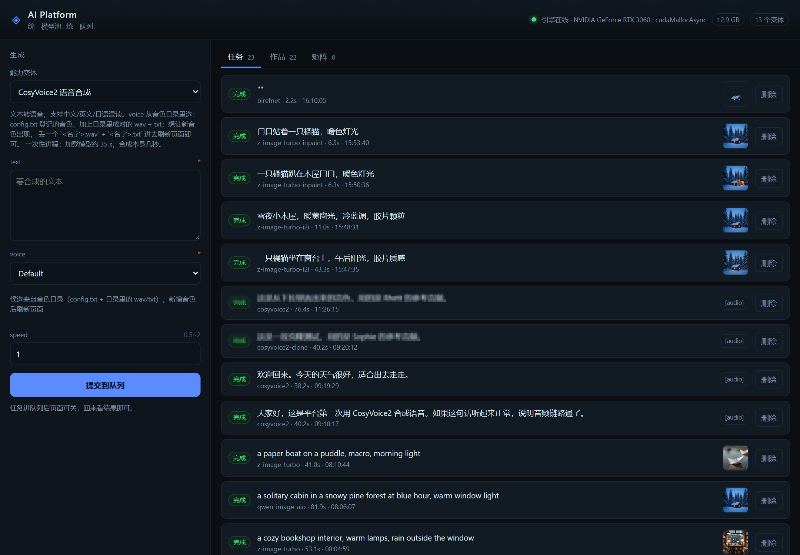
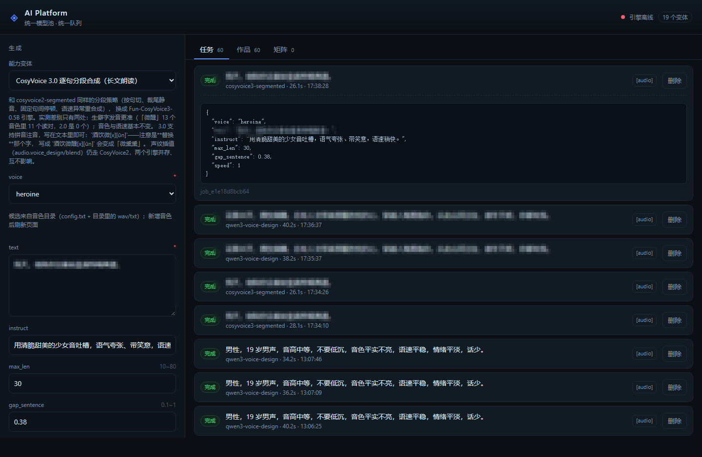
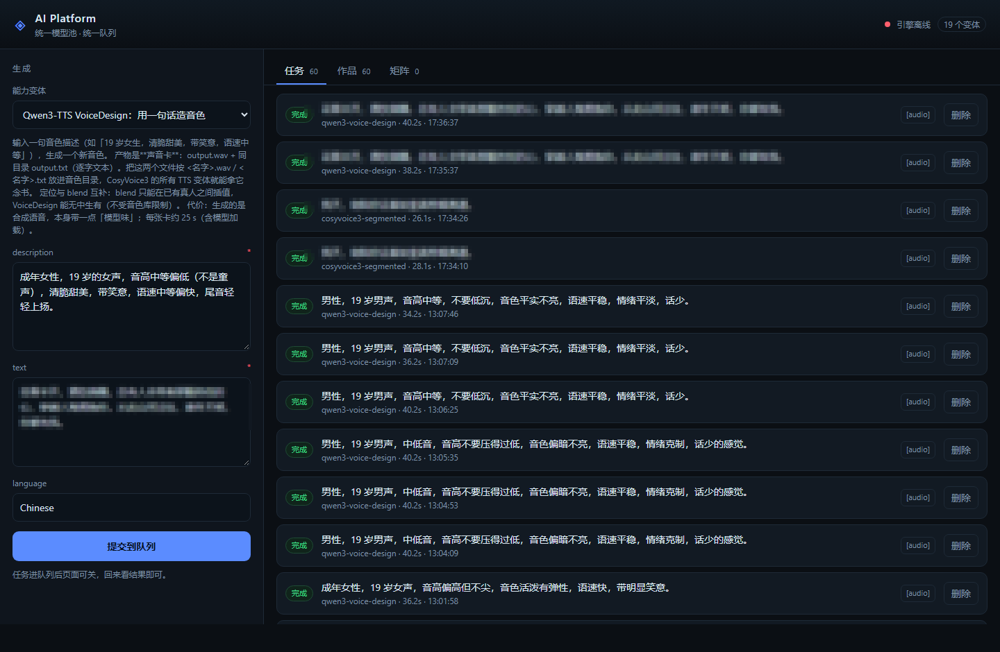
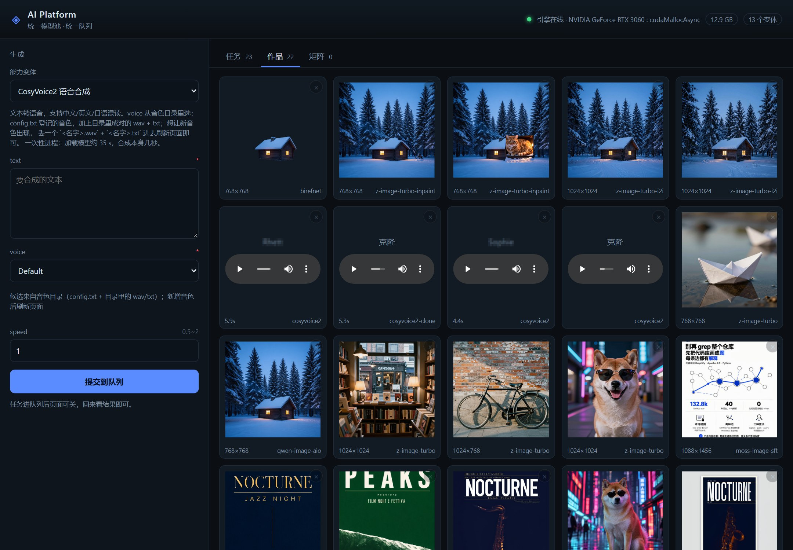
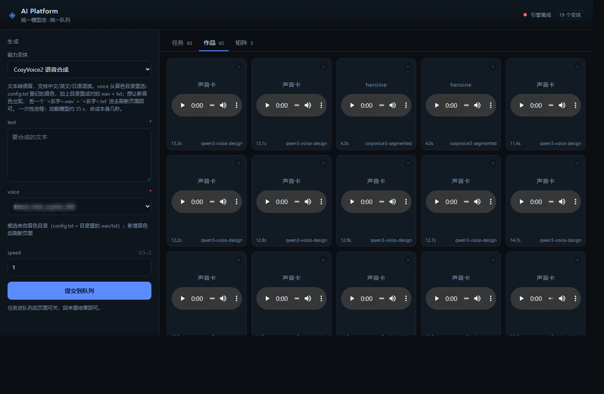
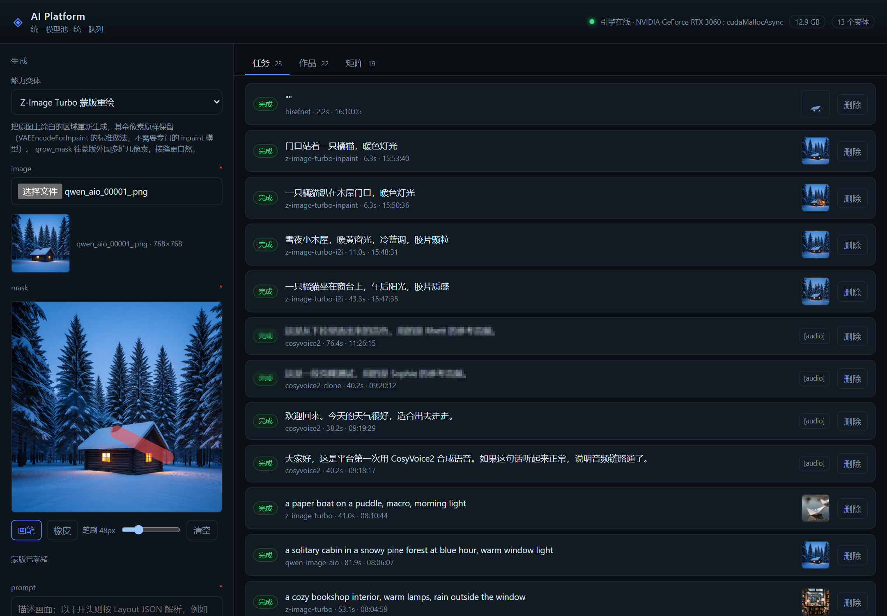
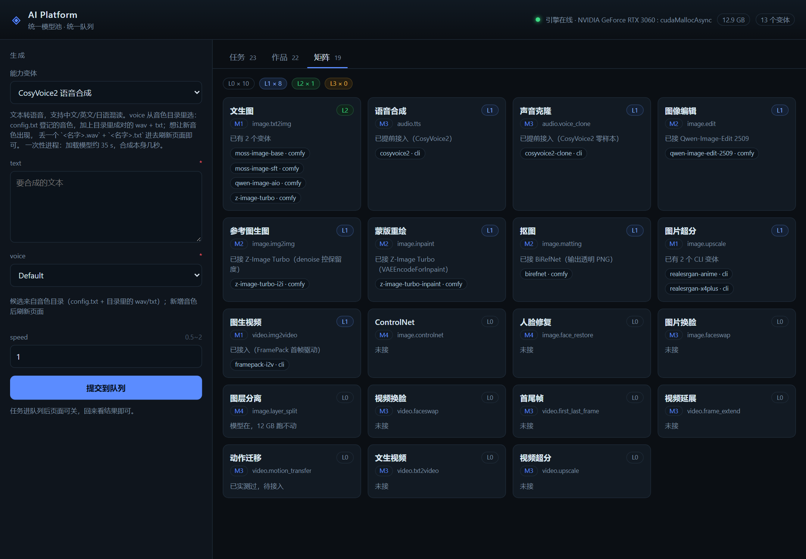

# mbai-platform

本机（RTX 3060 12GB / Windows）的**一站式 AI 能力平台**：统一模型池 + 统一队列 + 网页/Agent 双入口。

设计原则：**不自研推理内核**。ComfyUI 当模型运行时，平台只做控制平面（能力注册表、队列、产物、适配器）。

> 给 Agent / 新接手的人：先读 **[AGENTS.md](AGENTS.md)**，架构约束、契约、踩过的坑都在那里。

## 界面

**生成** —— 左边选能力和变体，表单按 `manifest.yaml` 的 `inputs` 自动生成（这里是 CosyVoice2 的音色下拉，
候选来自本机音色目录）；右边是统一队列，图片/音频/视频混在一个列表里，进度实时刷新。



**语音合成** —— 选 CosyVoice 3.0 变体，音色直接下拉（候选来自本机音色目录），
`instruct` 写自然语言情绪指令（"用清脆甜美的少女音吐槽，语气夸张、带笑意"），
分段长度 / 句间停顿 / 语速都有默认值。音频任务走本地 CLI 引擎，**ComfyUI 没开也能提交**——
所以这张截图顶部是「引擎离线」，任务照样 26 秒跑完。



**造音色** —— 一句话描述生成一张新音色卡（`output.wav` + 逐字文本 `output.txt`），
复制进音色目录后，上面所有 TTS 变体都能选到它。注意描述里的性别/音高不可靠，造完要量一次 F0 复核。



**作品墙** —— 三种产物并排，音频直接内联播放：TTS 卡片标音色名，造卡产物标「声音卡」，
点右上角 `×` 连任务带产物一起删。





**蒙版重绘** —— 在画布上直接涂（红色 = 要重画的区域），涂完停手约 0.5 秒自动上传，
然后照常提交；不需要专门的 inpaint 模型（见下面「蒙版重绘」一节）。



**能力矩阵** —— 19 项能力按成熟度 L0~L3 排，没接的直说「未接」，不糊弄。



## 目录

```
AGENTS.md        给 Agent 的交接文档（先读这个）
docs/            方案与实测记录（platform-plan-v2.md 是当前有效版本）
platform_core/   控制平面代码
apps/api/        FastAPI 入口（同时托管前端构建产物）
apps/web/        React + Vite 前端
capabilities/    能力清单：<能力>/<变体>/<版本>/{manifest.yaml,workflow.json}
models/          模型注册表（YAML，只有元数据，权重在 PLATFORM_MODELS_DIR）
profiles/        本机模型绑定（local.yaml 与 local-models.json 不入库，只提交 example）
scripts/         引导、下载、启动、验证脚本
.env.example     配置模板（复制成 .env，.env 不入库）
LICENSE/NOTICE   Apache-2.0 正文与第三方声明
engines/comfy/   ComfyUI 本体（git clone，不入库）
data/            SQLite、产物、日志（不入库）
```

## 快速开始

```powershell
# 0. 配置：复制模板，按本机改模型池等路径（详见下一节）
Copy-Item .env.example .env

# 1. 平台依赖
uv sync

# 2. 引擎：clone 固定 commit + 生成模型挂载 + 建 venv + 装 cu130 torch 与依赖
powershell -ExecutionPolicy Bypass -File scripts\bootstrap-comfy.ps1

# 3. 权重：按 models/*.yaml 的 source 字段还原（约 18.5 GB，走 hf-mirror，缺什么下什么）
uv run python scripts\download-models.py

# 4. 本地 CLI 工具（超分用，约 30 MB）
powershell -ExecutionPolicy Bypass -File scripts\download-tools.ps1

# 5. 前端
npm --prefix apps/web install
npm --prefix apps/web run build

# 6. 预检（注册表 / 模型文件 / 引擎 / MOSS 节点）
uv run mbai doctor

# 7. 跑一张（不走队列，看真实耗时）
uv run mbai run --variant moss-image-sft --prompt "一只戴墨镜的柴犬，赛博朋克街头"
```

## 配置（`.env`）

**所有本机差异都在仓库根目录的 `.env` 里**，代码里没有你的盘符。

- `.env` 已被 `.gitignore` 忽略，不会进版本库
- 模板是 [`.env.example`](.env.example)：`Copy-Item .env.example .env` 后按本机改
- 变量前缀统一 `PLATFORM_`，与 `platform_core/settings.py` 的字段一一对应
- `env_file` 钉在仓库根，**从任何工作目录启动都读同一份 `.env`**
- 改完 `.env` 要重启服务；只有 `mbai` 命令自己会重新加载

最小可运行配置（只跑图片/超分时只需要这两行）：

```ini
# 模型池：ComfyUI 的目录约定（diffusion_models/ text_encoders/ vae/ ...）
PLATFORM_MODELS_DIR=D:/models
# 已有 ComfyUI 安装的权重目录，只读挂载、不复制（JSON 数组，没有就写 []）
PLATFORM_EXTRA_MODEL_DIRS=["F:/AI/ComfyUI/models"]
```

| 变量 | 默认 | 说明 |
|---|---|---|
| `PLATFORM_MODELS_DIR` | `~/ai-models` | 模型热池，**必须按本机改** |
| `PLATFORM_EXTRA_MODEL_DIRS` | `[]` | 额外只读挂载（JSON 数组） |
| `PLATFORM_DATA_DIR` | `<仓库>/data` | 产物 / SQLite / 日志，跟着仓库走 |
| `PLATFORM_TOOLS_DIR` | `<仓库>/tools` | `download-tools.ps1` 的落地点 |
| `PLATFORM_COMFY_URL` | `http://127.0.0.1:8188` | ComfyUI 地址 |
| `PLATFORM_API_URL` | `http://127.0.0.1:8000` | 平台地址（MCP 客户端连它） |
| `PLATFORM_WORKER_CONCURRENCY` | `1` | 单卡串行；多卡再改 |

选装引擎（CosyVoice2 / CosyVoice3 / Qwen3-TTS / FramePack）各有一组路径变量，
见 `.env.example`。**没配也不会影响图片能力**：只在使用该变体时启动前报错，
提示你缺哪个变量，不会静默跑一个空路径。


可选：**音频引擎 CosyVoice2**（`audio.tts` / `audio.voice_clone` / `audio.voice_design` 用）。
它要独立 conda 环境和 4.8 GB 模型，不装不影响图片/视频：

```powershell
powershell -ExecutionPolicy Bypass -File scripts\bootstrap-cosyvoice.ps1
# 需要代理时（git / conda / pip 共用）：-Proxy http://127.0.0.1:7897
# 只要环境不要 4.8 GB 模型：-SkipModels
```

它做的事：clone CosyVoice 固定 commit `86e26f54` + Matcha-TTS 子模块 → 建 conda 环境
（python 3.10，pynini 来自 conda-forge）→ 装 torch 2.3.1+cu121 与锁定依赖 → 按 sha 下模型
（3.7 GB，约 40 分钟）→ 把 `PLATFORM_COSYVOICE_*` 写进 `.env`。幂等，断了重跑会从断点续。

模型**必须钉 revision**（`9d5c22a8`，2024-12-13）：2025-04-07 之后模型仓库把 `cosyvoice.yaml`
改成了 `cosyvoice2.yaml`、权重也换成 cache 版，需要更新的代码才认，而平台钉的 commit 只认旧版。
所以脚本不走 `modelscope` 的 snapshot 接口，改成按 sha 逐个文件下载。

日常运行是**两个进程**：

```powershell
# 窗口 A：引擎
powershell -ExecutionPolicy Bypass -File scripts\start-engine.ps1

# 窗口 B：平台（网页 + API 同一个端口）
uv run mbai serve --host 0.0.0.0 --port 8000
```

打开 **http://&lt;本机IP&gt;:8000** 即用。局域网内任何设备同一个地址，不需要再开第二个端口。
（换机器就换成那台机器的 IP，端口不变。）

> 引擎必须跑在 torch **cu130** 上，且**不要**加 `--lowvram`：cu128 会让量化算子退回 eager，
> MOSS-Image 从 1.5 s/it 掉到 6.2 s/it。详见 `docs/moss-image-integration.md`。

### 局域网打不开时先查这一条

Windows 防火墙对 `python.exe` 有**独立的程序级规则**，Block 优先于 Allow，命令行加的端口规则
（`New-NetFirewallRule -LocalPort 8000`）**不能替代**它。首次监听端口时系统会弹「允许访问」窗口，
必须在本机点同意；点过取消/关闭会在 `Public` 配置下留下 Block 规则。

症状：客户端浏览器报 **502**（而不是超时）——因为客户端代理连不上上游时会返回 502，很容易误导成服务挂了。

```powershell
# 看这个解释器有没有被挡
Get-NetFirewallApplicationFilter | Where-Object { $_.Program -match 'uv\\python' } |
  ForEach-Object { $_ | Get-NetFirewallRule } | Select DisplayName,Action,Profile,Enabled
```

## 资产（都不入库，全部可重建）

仓库里**没有任何权重、没有引擎源码、没有产物图**。每一样都有对应脚本，换机器只需按顺序跑：

| 资产 | 体积 | 脚本 / 命令 | 落地位置 |
|---|---|---|---|
| ComfyUI 本体（固定 `d07dff45`） | ~120 MB | `scripts\bootstrap-comfy.ps1` | `engines\comfy\` |
| `extra_model_paths.yaml`（模型挂载） | 几 KB | 同上（按 `-ModelsDir` / `-ExtraModelDirs` 生成） | `engines\comfy\extra_model_paths.yaml` |
| torch 2.14.1+cu130 三件套 | ~3 GB | `scripts\install-comfy-env.ps1`（bootstrap 会调） | `engines\comfy\.venv\` |
| ComfyUI Python 依赖 | ~1 GB | 同上 | 同上 |
| MOSS-Image 权重 4 个文件 | ~18.5 GB | `uv run python scripts\download-models.py` | `<PLATFORM_MODELS_DIR>\` |
| BiRefNet 抠图权重 | ~424 MB | 同上（`--only background_removal`） | `<PLATFORM_MODELS_DIR>\background_removal\` |
| Real-ESRGAN ncnn-vulkan 工具包 | ~30 MB | `powershell -File scripts\download-tools.ps1` | `tools\realesrgan\` |
| 前端依赖与产物 | ~50 MB | `npm --prefix apps/web install && npm run build` | `apps\web\` |
| CosyVoice 仓库（固定 `86e26f54`）+ Matcha-TTS 子模块 | ~120 MB | `scripts\bootstrap-cosyvoice.ps1`（可选） | `engines\cosyvoice\` |
| CosyVoice2-0.5B 模型目录（钉 revision `9d5c22a8`） | ~4.4 GB | 同上 | `engines\cosyvoice\pretrained_models\` |
| CosyVoice conda 环境（py3.10 + pynini + torch cu121） | ~7 GB | 同上 | 系统 conda `envs\cosyvoice\` |

下载脚本读的是 **`models/*.yaml` 的 `source` 字段**，不是写死的文件列表：加新模型只要在 YAML 里写清
`repo + remote 路径`，脚本不用改。同一份权重被多个变体共用（比如 MOSS 的文本编码器）只下一次。

- `--check` 只体检不联网；`--dry-run` 只打印命令；`--models-dir E:\models` 换存放位置；`--only vae` 只补单个文件
- 模型池位置可以和本机不同：`download-models.py --models-dir` 与 `PLATFORM_MODELS_DIR` 保持同一个值即可
- 没有 `source` 字段的模型视为「本机已有、不可自动还原」，`doctor` 会明确标出来

注意点：

- HuggingFace 走 `HF_ENDPOINT=https://hf-mirror.com`（脚本已设）；一次传多个 `--include` 会漏文件，所以脚本是**逐个下**
- PyPI 用官方源：清华镜像缺 `comfyui-workflow-templates-media-assets-02`
- torch 走 `download.pytorch.org/whl/cu130`，**不能用 cu128**
- `download-moss.ps1` 末尾会校验大小，抓「下到一半断掉」

## 网页界面

单端口方案：`apps/web` 构建到 `apps/web/dist`，由 FastAPI 挂 `StaticFiles` 托管在 `/`，
`/v1/*` 仍是 API。所以 `http://<本机IP>:8000` 一个地址同时是页面和接口。

- **日常使用**：`npm --prefix apps/web run build` 后重启服务即可
- **改前端时**：`npm --prefix apps/web run dev`（5173，热更新，`/v1` 自动代理到 8000）

页面能力：变体下拉 + 按 `manifest.yaml` 的 `inputs` 自动生成表单 + 任务列表（2s 轮询、可取消）
+ 作品墙。`type: image` 的参数是「选文件即上传」，表单里存 `asset_id`，worker 执行前解析成绝对路径
（超分这类能力就靠它）。`type: mask` 不出文件选择框，而是在原图上给一块涂抹画布（见「蒙版重绘」）。生成结果不满意可以直接删：任务行末尾的「删除」和作品缩略图右上角的 `×`，
删的是任务记录 + 磁盘产物文件，不可恢复，会先弹确认框。`prompt` 输入框以 `{` 开头时按 Layout JSON 解析
（排版控制，见 `docs/moss-image-integration.md`），否则按普通文本发送。

## Agent 入口（MCP）

同一个队列两个入口：网页给人，**MCP 给 Agent**。MCP 服务是个薄客户端，走 HTTP 调 `/v1/*`，
因此它能在别的机器上跑（`mbai mcp --url http://<本机IP>:8000`）。

客户端配置（Claude Desktop / opencode 这类）：

```json
{
  "mcpServers": {
    "mbai-platform": {
      "command": "uv",
      "args": ["run", "--directory", "<仓库绝对路径>", "mbai", "mcp"]
    }
  }
}
```

| 工具 | 用途 |
|---|---|
| `list_capabilities` | 全部变体 + 参数定义（`params` 能填什么、哪些必填） |
| `capability_matrix` | 成熟度矩阵，L0 = 还没接 |
| `upload_file` | 本地图片/音频 → `asset_id` |
| `submit` | 入队，立刻返回 `job_id` |
| `wait_job` | 阻塞到终态，返回产物**绝对路径** |
| `job_status` / `list_jobs` | 查单个 / 最近任务 |
| `cancel_job` | 取消排队中、执行中的任务 |

Agent 的一轮典型调用：

```
upload_file("D:/photos/a.png")                              → ast_xxx
submit("image.matting", "birefnet", {"image": "ast_xxx"})    → job_yyy
wait_job("job_yyy")  → succeeded + <仓库>\data\artifacts\job_yyy\matting_00001_.png
```

> 参数名和类型不是猜的：先 `list_capabilities`，`submit` 传错的键会被后端直接拒绝（422 原样回给 Agent）。

## 能力清单（当前）

| 能力 | 变体 | 模型 | 引擎 |
|---|---|---|---|
| `image.txt2img` | `z-image-turbo` | Z-Image Turbo 6B int8（8 步，快） | ComfyUI |
| `image.txt2img` | `qwen-image-aio` | Qwen-Image AIO 合并版（26.5 GB，质量档） | ComfyUI |
| `image.txt2img` | `moss-image-sft` | MOSS-Image 5B SFT int8（版式强） | ComfyUI |
| `image.txt2img` | `moss-image-base` | MOSS-Image 5B Base int8 | ComfyUI |
| `image.txt2img` | `sd15-community` | A1111 链过来的 SD1.5 检查点（8 个，下拉切换 + 可选 LoRA） | ComfyUI |
| `image.edit` | `qwen-image-edit-2509` | Qwen-Image-Edit 2509 fp8 + Lightning 4 步 | ComfyUI |
| `image.img2img` | `z-image-turbo-i2i` | Z-Image Turbo 6B int8（denoise 控保留度） | ComfyUI |
| `image.inpaint` | `z-image-turbo-inpaint` | Z-Image Turbo 6B int8（蒙版重绘） | ComfyUI |
| `image.matting` | `birefnet` | BiRefNet（输出透明 PNG） | ComfyUI |
| `image.upscale` | `realesrgan-anime` | realesr-animevideov3 | CLI（ncnn-vulkan） |
| `image.upscale` | `realesrgan-x4plus` | realesrgan-x4plus | CLI（ncnn-vulkan） |
| `audio.tts` | `cosyvoice2` | CosyVoice2-0.5B（零样本，音色从本机清单里选） | CLI（独立 conda 环境） |
| `audio.tts` | `cosyvoice2-instruct` | CosyVoice2-0.5B（音色 + 自然语言指令定情绪/语速） | CLI（独立 conda 环境） |
| `audio.voice_clone` | `cosyvoice2-clone` | CosyVoice2-0.5B（上传参考音频克隆） | CLI（独立 conda 环境） |
| `audio.voice_design` | `blend` | CosyVoice2-0.5B（两段嗓音插值成一个新音色） | CLI（独立 conda 环境） |
| `video.img2video` | `framepack-i2v` | FramePack I2V HY（首帧驱动，分节生成） | CLI（独立便携环境） |

### 换模型版本不用改代码

变体只声明「要哪些角色」（扩散模型 / 文本编码器 / VAE），具体用哪个文件由本机 `profiles/local.yaml` 决定：

```yaml
# profiles/local.yaml（不入库）
z-image-turbo:
  diffusion_model: diffusion_models/zImageTurboQuantized_fp8E4m3fn.safetensors
```

优先级：`profiles/local.yaml` → `profiles/default.yaml` → `models/*.yaml` 的 `files`。
换量化档、换自己 merge 的模型，只改这一行，变体/工作流/前端/Agent 全都不动。
详见 `profiles/example.yaml` 与 AGENTS.md §4.2。

### 运行时选权重（SD1.5 检查点 / LoRA）

老的 A1111 权重不用搬家，**符号链接进来即可**（不复制、不占空间、源目录照常用）。
源路径写在 `profiles/local-models.json`（不入库），先复制模板再改：

```powershell
Copy-Item profiles\local-models.example.json profiles\local-models.json   # 改成自己的路径
powershell -ExecutionPolicy Bypass -File scripts\link-local-models.ps1 -WhatIf  # 先预演
powershell -ExecutionPolicy Bypass -File scripts\link-local-models.ps1         # 建链接
```

清单两个字段：`links`（手工挑的单文件，逐条写理由）和 `bulk`（整目录镜像，LoRA 用）。
模型池路径取自 `.env` 的 `PLATFORM_MODELS_DIR`，也可以用 `-ModelsDir` 临时覆盖。

脚本把权重链到模型池的两个子目录，然后 `image.txt2img/sd15-community` 的
`checkpoint` / `lora` 下拉就自动列出来（候选是请求时现扫目录，刷新页面即可）：

```
<PLATFORM_MODELS_DIR>\checkpoints\sd15\   单文件链接（示例里 8 个 SD1.5 检查点）
<PLATFORM_MODELS_DIR>\loras\sd15\         整目录镜像（示例里 92 个 LoRA）
```

不想要的直接删链接，刷新页面候选就少了，不用改任何 YAML。
注意 SD1.5 原生 512，超过 768 容易出双头；画质本身打不过 z-image-turbo，
留着是为了风格专精（游戏图标、二次元线稿）和复现老图。

## 配置音色（语音合成）

`audio.tts` 的 `voice` 下拉来自**本机**的音色清单，加音色不用改代码、不用重启。
两个来源按名字合并（不区分大小写，`config.txt` 优先）：

### 方式 A：往音色目录丢一对文件（推荐）

目录由 `.env` 的 `PLATFORM_COSYVOICE_VOICES` 指定（示例见 `.env.example`）：

```
voiceclone/
  Xiaoming.wav     ← 参考音频
  Xiaoming.txt     ← 这段音频的逐字文本（UTF-8）
```

文件名（不含扩展名）就是下拉里显示的音色名。**两个文件缺一不可**——
没有 `.txt` 的 wav 不会出现，因为零样本合成必须知道音频里说的是什么，否则音色会跑偏。

### 方式 B：在 config.txt 登记

`PLATFORM_COSYVOICE_CONFIG` 指向的文件（格式沿用老项目，可留空）一行一个，格式 `名字|wav路径|参考文本`：

```
小明|./voiceclone/xiaoming.wav|今天天气不错，我们出去走走吧。
```

- 相对路径按 `config.txt` 所在目录解析，也可以写绝对路径（音频不在 voiceclone 里时用这个）
- 这是老 Flask 项目的格式，已经登记的照旧有效
- 名字重复时 `config.txt` 优先（`Alice` 和 `alice` 算同一个）

### 参考音频的硬要求

| 项 | 要求 |
|---|---|
| 时长 | 5~15 秒。太短音色不稳，太长没必要（参考音频整体要过一遍编码器） |
| 内容 | 单人说话、无背景音乐、无明显噪声 |
| 文本 | 必须和音频**逐字一致**，建议连标点一起抄——差一个字音色就会偏 |
| 格式 | wav 最稳；mp3/flac 也能读，但脚本会重采样到 16k，wav 最省事 |

### 生效与验证

改完**刷新页面**即可，清单每次请求现读，不用重启服务。命令行核对：

```powershell
uv run python -c "from platform_core.voices import list_voices; [print(v.name, v.source, v.wav) for v in list_voices()]"
```

`source` 是 `config` / `dir` / `builtin`，能看出这个音色是从哪儿来的。

### 一次性音色：不用动清单

只临时用一次的参考音频，直接用 `audio.voice_clone` 变体：上传音频 + 填逐字文本即可，
不写进任何目录。

### 选不到怎么办

| 现象 | 原因 |
|---|---|
| 新丢的 wav 没出现 | 缺同名 `.txt`，或 `.txt` 是空的 |
| `config.txt` 里加的不出现 | 路径写错 / 文件不存在；或整行以 `#` 开头被当注释跳过 |
| 下拉是空的 | `cosyvoice_home` 指错了，连兜底的 `asset/zero_shot_prompt.wav` 都找不到 |
| 提示「音色不存在」 | 入队前校验拦下的，按提示里的可选列表改名 |

## 双音色插值（音色设计）

`audio.voice_design/blend`：取两段参考音频的声纹向量做球面插值，合成一个**原本不存在**的音色，
再用这个音色把 `text` 读出来。用途是给小说配音/播报捏一个「不是任何一个真人」的声音。

| 参数 | 说明 |
|---|---|
| `voice_a` / `prompt_a` | A 的参考音频 + 它的逐字文本 |
| `voice_b` / `prompt_b` | B 的参考音频 + 它的逐字文本 |
| `ratio` | 0 = A，1 = B。**听感中点约 0.38~0.40，不是 0.5**（按 F0 校准出来的） |
| `text` / `speed` | 要合成的台词、语速 |

两段参考音频的时长不必相等（脚本会等长截断），但短的那段决定了可用 token 数，
**低于 5 秒会明显发飘**。单次约 55~100 秒，其中约 35 秒是模型加载。

产物是普通 wav。想让它变成常驻音色（之后在 `audio.tts` 下拉里直接选），
把 wav 和一段**与音频逐字一致**的 txt 一起放进音色目录即可，见上一节。

> 已知限制：插值点落在声纹空间的「无人区」，中间档（尤其 ratio 0.5~0.6）模型可能在男声/女声之间跳，
> 稳定性不如两端。要稳定就把结果固化下来再复用，不要每次重新插值。

## 蒙版重绘（局部重绘）

`image.inpaint` 只重画原图上涂出来的那块区域，其余像素原样保留。**不需要专门的 inpaint 模型**：
ComfyUI 的 `VAEEncodeForInpaint` 会把蒙版外的 latent 锁住，Z-Image Turbo 直接就能用。

用法：

1. 选「Z-Image Turbo 蒙版重绘」，上传原图
2. 在原图下方的画布上直接涂抹：**白（屏幕上显示成红色）= 要重画的区域**，橡皮擦掉 = 保留
3. 提示词描述**整个画面**（模型看到的是完整图 + 蒙版，不是只看那一小块），提交

几个细节：

| 项 | 说明 |
|---|---|
| 笔刷大小 | 是**原图像素**，不是屏幕像素。768 宽的图上 48px 约等于十六分之一宽 |
| `grow_mask` | 往蒙版外多扩几像素，默认 8。接缝生硬就调大，区域溢出就调小 |
| 什么时候生效 | 涂完停手约 0.5 秒自动上传，状态栏出现「蒙版已就绪」才算传上去 |
| 和原图的尺寸关系 | 画布按原图像素尺寸建，导出即对齐；**换原图会清空蒙版** |
| 输出尺寸 | 不是 8 的倍数时会裁掉几个像素（VAE 的硬要求），属于预期行为 |

命令行 / Agent 等价写法：蒙版就是一张黑白 PNG 素材（白 = 重绘），和图片走同一套 `POST /v1/assets`。

```powershell
uv run mbai run --capability image.inpaint --variant z-image-turbo-inpaint `
  --set image=ast_xxx --set mask=ast_yyy --prompt "门口站着一只橘猫，暖色灯光"
```

## 加一个新模型

1. `models/<id>.yaml`：写清 files / license / 12GB 可用性
2. `capabilities/<能力>/<变体>/v1/manifest.yaml`：参数表 + 工作流绑定
3. 同目录放 `workflow.json`（**API 格式**，从 ComfyUI 跑通后导出，别手写猜节点）
4. `mbai doctor` 应全绿

## 新增能力强约束

- 参数只走 `manifest.yaml` 的 `inputs`/`bindings`，代码不认识具体模型
- 权重只放 `PLATFORM_MODELS_DIR`（热池），历史权重用 `engines/comfy/extra_model_paths.yaml` 引用，不复制
- 每个产物都记录 `model_id`，方便溯源和 A/B

## 脚本索引

| 脚本 | 用途 | 何时跑 |
|---|---|---|
| `scripts\bootstrap-comfy.ps1` | clone ComfyUI 固定 commit、生成模型挂载、建 venv、装依赖 | 换机器 / 首次 |
| `scripts\install-comfy-env.ps1` | 只装 cu130 torch + ComfyUI 依赖 | 依赖坏了重装 |
| `scripts\download-models.py` | 按注册表还原权重（`--check` 体检 / `--dry-run` 预览 / `--models-dir` 换位置） | 换机器 / 权重损坏 |
| `scripts\download-tools.ps1` | 下载并解压 Real-ESRGAN ncnn-vulkan 工具包（幂等） | 换机器 / 用超分 |
| `scripts\bootstrap-cosyvoice.ps1` | 还原音频引擎：clone CosyVoice 固定 commit、建 conda 环境、装依赖、下 4.8 GB 模型、写 `.env`（幂等） | 换机器 / 想用 TTS |
| `scripts\start-engine.ps1` | 启动引擎（8188） | 每次开机 |
| `scripts\smoke-test.py` | HTTP + 队列端到端冒烟 | 改完控制平面 |
| `scripts\test-layout.py` | Layout JSON 版式落位验证 | 改 prompt 注入 |
| `scripts\check-nodes.py` | 检查引擎里 MOSS 节点是否在 | 引擎异常 |
| `scripts\job-status.py` | 查单个任务状态 | 排查卡单 |
| `mbai gc` | 按 TTL 清理中间产物（默认预演，`--apply` 才删） | 每周 / 磁盘吃紧时 |
| `mbai mcp` | 起 MCP 服务（stdio），把能力暴露给 Agent | Agent 接入时 |

## 许可证

本仓库的代码以 **Apache License 2.0** 发布，全文见 [LICENSE](LICENSE)。

```
Copyright 2026 mousebomb
```

第三方代码与资源的来源、许可、适用边界记在 [NOTICE](NOTICE) 里，几条容易搞混的：

- **权重不在本仓库**。每个模型的许可、能否商用、能否一键还原写在 `models/*.yaml` 的
  `license` / `commercial_ok` / `restorable` 字段里；`unknown` 表示**未核实**，不是「允许使用」。
- **ComfyUI 是 GPL-3.0，但本仓库不是它的衍生作品**：本仓库不含 ComfyUI 源码，也不与它链接，
  只通过 HTTP 调用（提交 API 格式工作流、轮询历史、下载产物）。重新分发 ComfyUI 本身时
  仍需遵守 GPL-3.0。
- **`scripts/engines/framepack_i2v.py` 派生自 FramePack**（Apache-2.0）的 `demo_gradio.py`，
  保留上游版权与许可声明。
- 前端依赖（React / axios / Vite / TypeScript）各自 MIT 或 Apache-2.0，见 `apps/web/package-lock.json`。

## 使用边界

- **不要直接映射到公网**：接口没有鉴权，`CORS` 全放开，设计前提是内网单人使用。
- **声音克隆只用于你有权使用的音频**：本人声音、已获授权的声音，或明确允许再创作的素材。
  拿真人声音做克隆再发布，多数司法辖区都涉及人格权/声音权，与本项目许可无关。
- 模型输出的版权与合规责任在使用者一侧，本仓库只提供调度能力。

## 第三方与致谢

- [ComfyUI](https://github.com/comfyanonymous/ComfyUI)：模型运行时
- [FramePack](https://github.com/lllyasviel/FramePack)：视频生成脚本的上游
- [CosyVoice](https://github.com/FunAudioLLM/CosyVoice)、[Qwen3-TTS](https://github.com/QwenLM/Qwen3-TTS)：语音引擎
- [Real-ESRGAN](https://github.com/xinntao/Real-ESRGAN)、[BiRefNet](https://github.com/ZhengPeng7/BiRefNet)：超分与抠图
- 模型提供方：MOSS / 通义 Z-Image / Qwen-Image / Qwen3-TTS / BiRefNet 等，许可见 `models/*.yaml`

